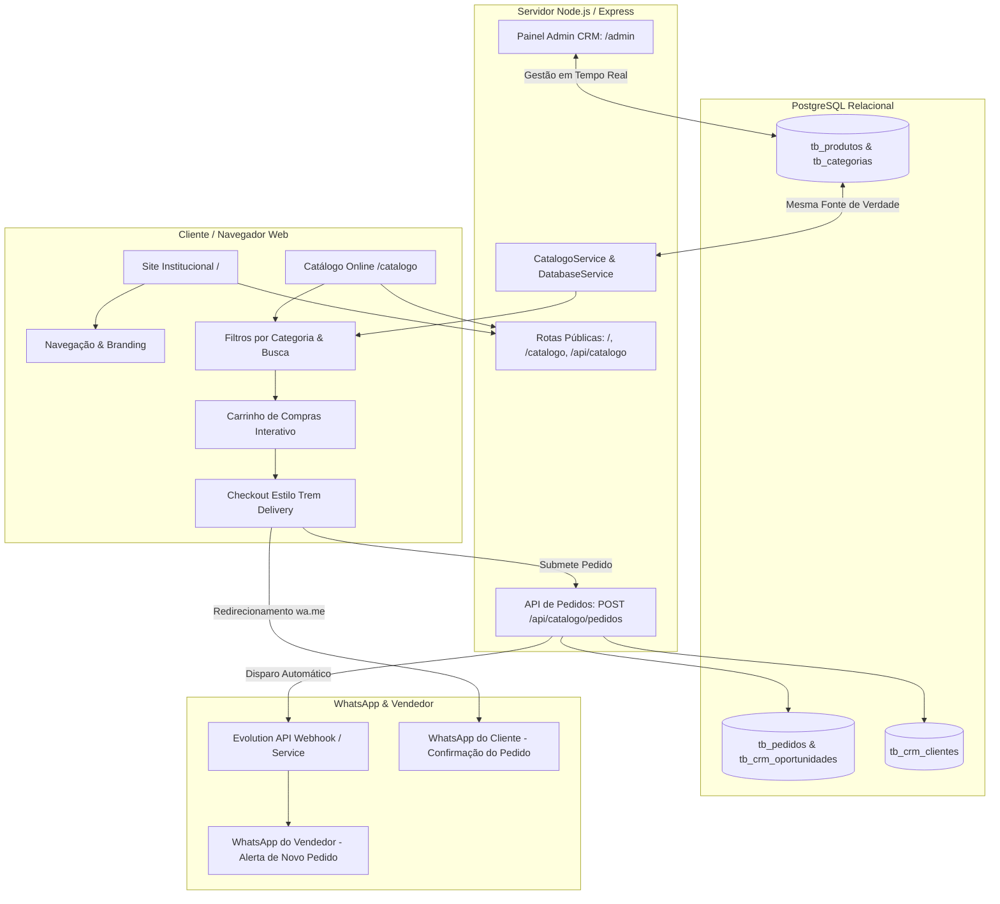

# Roadmap Oficial: Reconstrução do Site Apiário Favo de Mel & Catálogo Integrado

> **Projeto:** Apiário Favo de Mel (Remoção do WordPress & Criação do Catálogo Digital Integrado)  
> **Status:** ⏸️ **PAUSADO A PEDIDO DO USUÁRIO - PONTO DE RETOMADA PRONTO**  
> **Última Atualização:** 15/10/2026 20:57  
> **Arquitetura Base:** Node.js (Express), PostgreSQL, Evolution API (WhatsApp), Vanilla HTML5/CSS3/JS (Zero WordPress).  
> **Origem dos Dados & Ativos:** Backup WordPress (`public_html/wp-content/uploads`) e Banco de Dados Local/PostgreSQL (`tb_produtos`, `tb_categorias`, `tb_crm_clientes`).

---

## 📍 PONTO EXATO DE RETOMADA (Checklist de onde paramos)

### ✅ Já Realizado Nesta Sessão:
1. **Ativos Visuais:** Copiados 23 arquivos base do site institucional (`public/site-assets/`) e 114 fotos reais de produtos (`public/site-assets/products/`).
2. **Banco de Dados:** Sincronizados 24 produtos no PostgreSQL (`tb_produtos`) com fotos reais, descrições ricas, categorias e preços corretos via `scripts/sincronizar_fotos_produtos.js`.
3. **Tabela de Pedidos:** Tabela `tb_pedidos` modelada e adicionada em `DatabaseService.js`.
4. **Motor de Pedidos & WhatsApp:** Criado `src/services/PedidoService.js` com persistência de pedidos, disparo automático para o WhatsApp do vendedor via Evolution API, criação automática de oportunidade no Kanban do CRM e geração de link `wa.me` para o cliente.
5. **Roadmap Oficial:** Criado `ROADMAP_CATALOGO.md`.

---

### ⏭️ Próximas Ações Imediatas ao Retornar:
1. **[Fase 1]** Criar o front-end do site institucional limpo (`src/views/site.ejs` ou `public/index.html`) com a identidade visual original (Lora/Nunito, dourado/preto, hero, contadores, quem somos, serviços, redes sociais, contato) e servir em `GET /`.
2. **[Fase 2]** Criar a vitrine pública do catálogo interativo (`src/views/catalogo.ejs` em `GET /catalogo`) com filtros de categorias, busca instantânea, cards com fotos reais e carrinho flutuante estilo Trem Delivery.
3. **[Fase 3]** Conectar a rota `POST /api/catalogo/pedidos` com o checkout no front-end (modal com PIX QR Code/Chave, Cartão, Dinheiro) e teste de envio de pedido para o WhatsApp do vendedor.
4. **[Fase 4]** Montar a interface de CRUD de produtos no Dashboard CRM para sincronização bidirecional.
5. **[Fase 5]** Empacotar a versão final para publicação na Hostinger.

---

## 🎯 Visão Geral & Objetivos

Substituir o site institucional legado em WordPress (Elementor/LiteSpeed/PHP) por uma solução moderna, ultra-rápida, segura e 100% sob medida em Node.js e HTML5/CSS3, preservando a identidade visual, paleta de cores (dourado/âmbar, preto e tons quentes de mel), tipografia e seções originais.

Além disso, incorporar um **Catálogo Digital Interativo (Vitrine Virtual)** inspirado no modelo *Trem Delivery*, permitindo que clientes naveguem pelos produtos cadastrados no WhatsApp/CRM, montem seu carrinho e finalizem o pedido com envio automático e imediato para o WhatsApp do vendedor.

---

## 🗺️ Fases do Roadmap & Checklist de Entrega

### 🌟 Fase 1: Reconstrução do Site Institucional (Zero WordPress)
*Objetivo:* Reproduzir fielmente o design do Apiário Favo de Mel em HTML5/CSS3 moderno e responsivo, eliminando qualquer dependência de WordPress, Elementor ou PHP.
- [x] Extração e inventário de todos os 23 ativos visuais essenciais (logo, fotos do apiário, ícones, imagens de serviços).
- [x] Cópia dos ativos em alta resolução para `public/site-assets/`.
- [ ] Criação do template limpo do site institucional (`src/views/site.ejs` ou `public/index.html`):
  - [ ] **Header:** Logo original, menu de navegação fluido (Início, Quem Somos, Produtos, Serviços, Contato) e botão de destaque para o Catálogo.
  - [ ] **Hero Section:** Banner principal com slogan original, CTA de compra no WhatsApp e imagem em destaque do Kit Presente.
  - [ ] **Números / Métricas:** Indicadores animados do apiário (+10 anos, 100% natural, etc.).
  - [ ] **Quem Somos:** História do Apiário Favo de Mel com foto do apicultor e compromisso sustentável.
  - [ ] **Vitrine de Produtos em Destaque:** Cards elegantes com foto, descrição e botão "Comprar / Ver no Catálogo".
  - [ ] **Nossos Serviços:** 4 serviços especializados com imagens originais (Resgate e Captura, Consultoria para Apiário, Manejo Apícola, Transferência de Abelhas).
  - [ ] **Redes Sociais:** Chamada visual para o Instagram `@favodemel_apis`.
  - [ ] **Contato & Localização:** Telefones, links WhatsApp diretos, horário de funcionamento e rodapé completo.
- [ ] Otimização para dispositivos móveis (100% responsivo, carregamento instantâneo).

---

### 🛒 Fase 2: Vitrine Digital & Catálogo Interativo (`/catalogo`)
*Objetivo:* Criar a experiência de compra mobile-first onde o cliente navega por categorias, visualiza fotos reais dos produtos cadastrados no CRM/WhatsApp e adiciona ao carrinho.
- [ ] Rota pública `/catalogo` com visual limpo, moderno e focado em conversão.
- [ ] Integração com `CatalogoService.js`: listar automaticamente todas as categorias e produtos ativos do banco PostgreSQL (`tb_produtos` e `tb_categorias`).
- [ ] Filtro por categoria (pills horizontais deslizáveis) e campo de busca rápida em tempo real.
- [ ] Cards de produtos com:
  - [ ] Foto real do produto com tratamento visual e zoom/modal.
  - [ ] Nome e descrição completa.
  - [ ] Preço formatado em R$ (Real Brasileiro).
  - [ ] Botão de adicionar ao carrinho com feedback tátil e sonoro sutil.
- [ ] Gaveta de Carrinho Flutuante (*Floating Cart Drawer*):
  - [ ] Contador de itens no botão flutuante.
  - [ ] Listagem de itens com ajuste de quantidade (+ / -) e remoção.
  - [ ] Cálculo dinâmico do subtotal em tempo real.
  - [ ] Botão "Avançar para o Checkout".

---

### ⚡ Fase 3: Checkout Trem Delivery & Disparo para WhatsApp
*Objetivo:* Checkout simples, sem fricção, sem necessidade de login prévio e com notificação instantânea para o vendedor no WhatsApp.
- [ ] Modal/Etapa de Checkout com formulário intuitivo:
  - [ ] Nome completo do cliente.
  - [ ] Número de WhatsApp com máscara (ex: `(79) 99999-9999`).
  - [ ] Modalidade: **Entrega** ou **Retirada no Apiário**.
  - [ ] Se Entrega: campos de CEP (opcional), Rua, Número, Bairro, Cidade e Complemento (sem cálculo de frete por enquanto, conforme solicitado).
  - [ ] Forma de Pagamento:
    - **PIX:** Exibição da Chave PIX oficial e botão "Copiar Chave", além de QR Code estático/dinâmico.
    - **Cartão (Débito/Crédito na Entrega)**.
    - **Dinheiro:** Com opção de informar troco.
  - [ ] Campo de observações adicionais.
- [ ] Endpoint backend `POST /api/catalogo/pedidos`:
  - [ ] Persistência do pedido na tabela `tb_pedidos`.
  - [ ] Auto-registro ou atualização do cliente em `tb_crm_clientes`.
  - [ ] Geração de oportunidade no CRM Kanban (`tb_crm_oportunidades`) na etapa "Aguardando Pagamento".
  - [ ] Envio automático de notificação com resumo detalhado do pedido via Evolution API para o WhatsApp do Vendedor (`NUMERO_DA_LOJA`).
  - [ ] Retorno da URL formatada do WhatsApp (`wa.me`) para abertura direta no dispositivo do cliente.

---

### 🔄 Fase 4: Sincronização Bidirecional (Site <-> CRM <-> WhatsApp Bot)
*Objetivo:* Garantir que qualquer produto adicionado, editado ou desativado no painel do CRM seja refletido instantaneamente no site e no bot de WhatsApp.
- [ ] Rota e tela administrativa para Gerenciamento de Produtos (`/admin/catalogo`):
  - [ ] Listagem completa com busca e filtros por status (ativo/inativo).
  - [ ] Cadastro e edição de produtos (Nome, Categoria, Preço, Descrição, Estoque, URL/Upload de Foto).
  - [ ] Ativação/Desativação com 1 clique (toggle switch).
  - [ ] Exclusão segura.
- [ ] Invalidação automática de cache em memória (`CatalogoService.invalidarCache()`) a cada alteração.
- [ ] Migração inicial de todos os produtos do catálogo WhatsApp (`tb_produtos`) com vínculo às suas fotos reais da pasta `public/site-assets/products/`.

---

### 📦 Fase 5: QA, Validação & Empacotamento para Hostinger
*Objetivo:* Testar todos os fluxos de ponta a ponta e preparar o pacote de publicação para Hostinger.
- [ ] Testes de usabilidade em desktop e mobile (navegação, carrinho, checkout).
- [ ] Teste de recebimento do pedido no WhatsApp do vendedor via Evolution API.
- [ ] Teste de sincronização de alteração de preços e produtos no Dashboard CRM.
- [ ] Script de build/exportação estática/Node para deploy limpo na Hostinger substituindo a pasta `public_html`.
